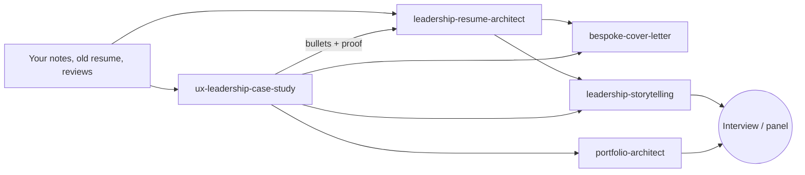

# Leadership Career Skills

**Evidence-based AI skills for design and UX leaders on the job market.** Six skills for resumes, leadership case studies, stories, cover letters, and portfolios. They follow the [Agent Skills](https://agentskills.io) format, so they run in **Claude Code**, the **Claude app**, and **ChatGPT**.

They are built on hiring data and on what design-leadership hiring managers say they reward. Generic career advice (one page, skill bars, "results-driven leader") is left out. One rule runs through all six: **never invent a metric.** Missing numbers become visible placeholders for you to fill in.

[](https://github.com/blisse-code/leadership-career-skills/actions/workflows/validate.yml)


---

## The skills

| Skill | What it does | Try saying |
|---|---|---|
| [`leadership-resume-architect`](plugins/leadership-career-skills/skills/leadership-resume-architect/SKILL.md) | Writes Lead to VP/CDO resumes and CVs as mandate, move, measure. Adds a scope line per role and uses the level ladder. Follows ATS rules and CV conventions by country. Outputs .docx plus an evidence log. Bundled `render_resume_docx.py` and `ats_check.py` | "Build my resume for this Director of Product Design role in Berlin. Here are my notes and the JD." |
| [`ux-leadership-case-study`](plugins/leadership-career-skills/skills/ux-leadership-case-study/SKILL.md) | Writes case studies that prove how you led: decision map, responsibility map, messy middle, outcomes with counter-metrics. Adds a 30-second exec skim, a panel deck outline, and a 12-point rubric | "Turn my design system project into a leadership case study for Head of Design interviews." |
| [`leadership-storytelling`](plugins/leadership-career-skills/skills/leadership-storytelling/SKILL.md) | Builds interview story banks, "tell me about yourself", panel talk tracks, a career walking deck, 30-60-90 plans, and pitches to executives. Also vision, change, and bad-news narratives | "I have a Director panel next week. Build my story bank and a 90-second intro." |
| [`tailored-resume-generator`](plugins/leadership-career-skills/skills/tailored-resume-generator/SKILL.md) | Tailors a resume to one job for non-leadership roles, with exact-title and keyword mapping and no fabrication. Hands leadership roles to the resume architect | "Tailor my resume to this UX Designer posting." |
| [`bespoke-cover-letter`](plugins/leadership-career-skills/skills/bespoke-cover-letter/SKILL.md) | Writes a one-page letter built on a 7-move structure (cold open to landing line). Calibrates to leadership level and checks facts against your resume and case studies | "Write my cover letter for this role." |
| [`principal-head-experience-ai-portfolio-architect`](plugins/leadership-career-skills/skills/principal-head-experience-ai-portfolio-architect/SKILL.md) | Plans a whole portfolio for Principal, Head of Experience, and AI leadership roles: sitemap, proof map, case selection, a skeptic review, and a visual system | "Plan my leadership portfolio for Head of Design roles in Europe." |

### How they fit together



Recommended order for one application: **resume, then 2-3 case studies, then the cover letter, then storytelling for panel prep.** Each skill reads what the earlier ones produced, so titles, dates, and numbers stay consistent. Mismatched facts are a common reason reference checks go wrong.

---

## Install

### Claude Code: plugin (recommended)

```bash
claude plugin marketplace add blisse-code/leadership-career-skills
claude plugin install leadership-career-skills@blisse-code-skills
```
Or inside a session: `/plugin marketplace add blisse-code/leadership-career-skills`, then `/plugin`. Plugin skills are namespaced, e.g. `/leadership-career-skills:leadership-resume-architect`, and Claude also triggers them automatically from your request. Update later with `claude plugin marketplace update blisse-code-skills`.

### Claude Code: plain skills folder

```bash
curl -fsSL https://raw.githubusercontent.com/blisse-code/leadership-career-skills/main/scripts/install.sh | bash
# or, from a clone:
./scripts/install.sh                        # all skills into ~/.claude/skills
./scripts/install.sh --project              # into ./.claude/skills for one repo
./scripts/install.sh leadership-storytelling  # just one
```
Existing skills with the same name are backed up first, not overwritten.

### Claude app (claude.ai, desktop, mobile)
1. Download the `.skill` files from the [latest release](https://github.com/blisse-code/leadership-career-skills/releases/latest).
2. **Customize > Skills > +**, then upload each one. Code execution must be on for the bundled scripts.

### ChatGPT
- **Business, Enterprise, Edu (Skills):** upload the `*-chatgpt.zip` files from the release. They use the same SKILL.md format, with a short ChatGPT note added. In `bespoke-cover-letter`, file delivery and memory steps are adapted for ChatGPT. Sources: [chatgpt/skills](chatgpt/skills).
- **Plus / Pro (Custom GPTs):** use `custom-gpts-fallback.zip` from the release for the three new skills. Create a GPT, paste `instructions.txt` into Instructions (each is under 8,000 characters), upload the `knowledge/` files, and turn on Code Interpreter. Details: [chatgpt/README.md](chatgpt/README.md).

### Any other Agent Skills tool
Copy a folder from `plugins/leadership-career-skills/skills/` into your tool's skills directory. Each folder is self-contained.

---

## What makes these different

| Principle | Where it comes from |
|---|---|
| **Two pages for leaders** by default, with page 1 able to stand alone | ResumeGo: hiring professionals preferred two-page resumes 2.9x for managerial roles |
| **Exact job title in the headline**, JD phrases used in context, no keyword stuffing | Jobscan ATS data; TheLadders eye-tracking (about 7 s first pass, stuffing hurt) |
| **Mandate, business impact, leadership leverage**, calibrated by level (Manager, Director, VP, CDO) | Design-leadership hiring posts; McKinsey *Business Value of Design* |
| **Decisions over deliverables**; "tell a messy story"; credit the team | Adobe Design; DoorDash (Helena Seo); NN/g portfolio research |
| **Seniority signals**: initiative, product thinking, scope, innovation | Leslie Yang, design hiring manager |
| **Challenge, choice, outcome**; answer first for execs; what is vs what could be for teams | Ganz, Minto, Duarte, Simmons, Denning, Heath |
| **Evidence or placeholder**: every claim traced to a source or marked `[Need number]` | Common to all six skills |

Full source list with what each contributed and confidence notes: [docs/research-basis.md](docs/research-basis.md).

---

## Tested

Built with Anthropic's `skill-creator` process. There were 9 realistic test prompts, including director resumes, an IC-to-manager move, thin-input case studies, a CFO pitch, and a panel story bank. Each was run by an independent agent **with** the skill and **without** it (for the updated skills, against the previous version). There were two iterations.

| | Baseline | With skills |
|---|---|---|
| Automated assertion pass rate | 72% | 95% |

What the assertions checked: exact title present, scope lines, no unsupported percentages or currency figures, decision blocks, responsibility maps, placeholders instead of invented data, market conventions, and no em dashes or banned hype words. Test inputs are fictional personas. See [evals/](evals/), including the full side-by-side [review viewer](evals/results/review-viewer.html) (download and open locally).

---

## Repository layout

```
.claude-plugin/marketplace.json        Claude Code marketplace manifest
plugins/leadership-career-skills/      The plugin (source of truth)
  .claude-plugin/plugin.json
  skills/<skill>/SKILL.md              + references/ and scripts/
chatgpt/skills/                        ChatGPT editions (same format)
chatgpt/custom-gpts/                   Custom GPT instructions (Plus/Pro fallback)
docs/                                  Research basis, design notes
evals/                                 Test prompts, fictional inputs, grader, results
scripts/                               validate.py, build.py, install.sh
.github/workflows/                     CI validation + release packaging on tags
```

## Contributing

Issues and PRs are welcome. Especially: new country CV conventions, better evidence sources, and eval cases that break a skill. Read [CONTRIBUTING.md](CONTRIBUTING.md). Run `python scripts/validate.py` before opening a PR.

## Credits and license

MIT, see [LICENSE](LICENSE). Exception: `tailored-resume-generator` is a modified version of the skill of the same name in [ComposioHQ/awesome-claude-skills](https://github.com/ComposioHQ/awesome-claude-skills) and stays under Apache 2.0 (see its `NOTICE.md`). It has been largely rewritten, and the original's fabricated-metric example has been removed. The research sources listed in `docs/research-basis.md` belong to their authors. These skills summarise their ideas and don't reproduce their text.

**Not career, legal, or immigration advice.** Check country conventions and visa matters with the employer or a qualified adviser.
